  <a href="https://alexandremilharado.github.io/Portfolio">
    <picture>
      <source media="(prefers-color-scheme: light)" srcset="./assets/header-light.svg" />
      
    </picture>
  </a>

  
  
  
  
  

## 👋 About

I'm a **Junior Machine Learning Engineer at [LTPLabs](https://www.ltplabs.com)** in Lisbon. I hold a BSc and an
MSc in Computer Engineering from ISCTE, ranking in the top 5% of my class in both, and worked as a
Teaching Assistant for Introduction to Programming and Concurrent & Parallel Programming. I work on computer
vision and reinforcement learning, and I build the backend systems around them.

## 🧪 Selected work

  <a href="https://alexandremilharado.github.io/Portfolio"><picture>
    <source media="(max-width: 600px) and (prefers-color-scheme: light)" srcset="./assets/cards/coloring-events-narrow-light.svg" />
    <source media="(max-width: 600px)" srcset="./assets/cards/coloring-events-narrow.svg" />
    <source media="(prefers-color-scheme: light)" srcset="./assets/cards/coloring-events-light.svg" />
    
  </picture></a>

  <a href="https://github.com/AlexandreMilharado/Autonomous-Navigation"><picture>
    <source media="(prefers-color-scheme: light)" srcset="./assets/cards/autonomous-navigation-light.svg" />
    
  </picture></a>
  <a href="https://github.com/AlexandreMilharado/Spot-Discovery"><picture>
    <source media="(prefers-color-scheme: light)" srcset="./assets/cards/spot-discovery-light.svg" />
    
  </picture></a>

  <a href="https://github.com/pafmoura/KJSON"><picture>
    <source media="(prefers-color-scheme: light)" srcset="./assets/cards/kjson-light.svg" />
    
  </picture></a>
  <a href="https://github.com/K3vinb5/Projeto_PISID_Grupo_12"><picture>
    <source media="(prefers-color-scheme: light)" srcset="./assets/cards/mongo-mysql-streamer-light.svg" />
    
  </picture></a>

## 🛠️ Toolkit

| | |
|---|---|
| **Languages** |       |
| **ML / Data** |        |
| **Backend & Web** |      |
| **Databases** |    |
| **RL & Simulation** |   |
| **Tools** |    |

---

  Always happy to talk computer vision, reinforcement learning, or ML systems — reach out via any link above.

